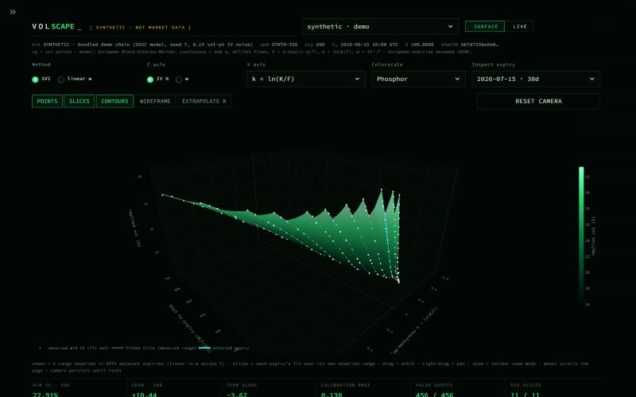
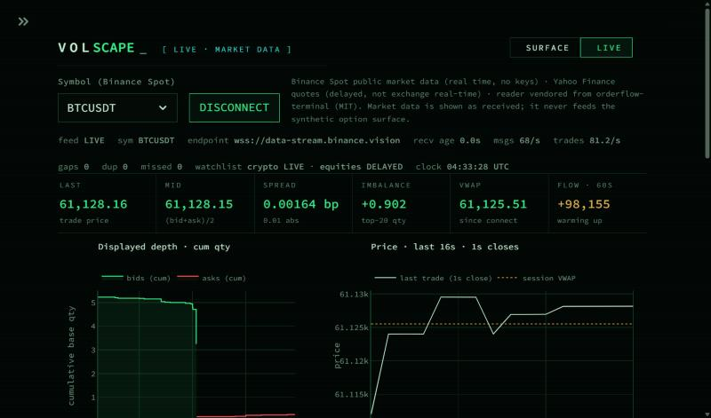
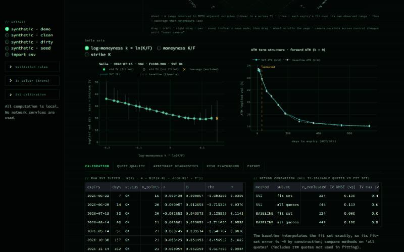

# VOLSCAPE

A local options-volatility research workstation with two workspaces:

- **SURFACE** (offline): validate an option chain, solve bid/mid/ask implied vols, fit an inspectable
  surface (total-variance interpolation baseline and raw SVI), audit it with static-arbitrage
  diagnostics, and stress a small European portfolio.
- **LIVE** (opt-in): real-time Binance Spot order flow (book depth, trade tape, signed flow, VWAP) plus a
  delayed watchlist of crypto, NIFTY/SENSEX, US and global indices and stocks. It uses the market-data
  reader from [orderflow-terminal](https://github.com/jaisnavbuildsrandomshit/orderflow-terminal), vendored
  under `volscape/live/` (MIT).

Built with Python, NumPy, SciPy, pandas, Plotly and Streamlit. No accounts, API keys or paid services.

> The bundled option chains are **SYNTHETIC**, generated from a disclosed SSVI model with a fixed seed.
> LIVE data is real **spot** and equity market data; it contains no option quotes and never feeds the
> synthetic surface or the risk scenarios. Each view is labelled with its data kind.



| LIVE order flow | Smile · term structure · calibration |
|---|---|
|  |  |
| **Arbitrage diagnostics** | **Risk playground** |
|  |  |

*All screenshots were captured from the running app. SURFACE uses the bundled synthetic demo; LIVE
shows the public BTCUSDT feed at the moment of capture. The smile, arbitrage and risk captures predate
the latest layout pass (legends moved below charts, controls moved to a strip).*

## Network use
SURFACE computation never uses the network: Streamlit and Plotly serve their own bundled assets.
LIVE opens connections **only after you press Connect**, and only to:
- `data-stream.binance.vision` / `stream.binance.com` (WebSocket, public market data);
- `data-api.binance.vision` / `api.binance.com` (REST klines for sparklines);
- `query1/query2.finance.yahoo.com` (delayed quotes).

The connections stay open in every workspace until you press Disconnect in LIVE; while they are open,
the SURFACE header shows `◉ live feed connected`. If Binance is restricted in your region, the status line shows the
HTTP error and values stay N/A or empty; nothing is filled in.

## Quick start

Requires Python 3.11+ (3.12 recommended). The first run needs internet once to install pinned wheels.
After that the app works fully offline: Streamlit and Plotly serve their bundled assets locally.

**Windows** (PowerShell, or double-click `start.cmd`)
```powershell
.\start.cmd
```
In `cmd.exe`, type `.\start.cmd` with the path: a bare `start.cmd` is parsed as cmd's built-in `start`.
**macOS / Linux**
```bash
chmod +x start.sh && ./start.sh
```
Then open http://127.0.0.1:8501. Use the SURFACE / LIVE switch at top right; advanced validation,
IV-solver and SVI settings are in the collapsible sidebar (») . Both scripts locate their own folder, pick a suitable Python, create
`.venv`, install `requirements.txt` only when it changes, and print actionable errors. They never change
global settings. Run the test suite with `.\start.cmd test` or `./start.sh test`.

Manual equivalent:
```bash
python -m venv .venv
.venv/Scripts/python -m pip install -r requirements.txt     # macOS/Linux: .venv/bin/python
.venv/Scripts/python -m streamlit run app.py
```

## Workflow
1. **Load**: bundled synthetic demo, clean fixture, deliberately dirty fixture, a freshly seeded
   synthetic chain, or **import a CSV**. A failed import is reported with row-level reasons. The demo is
   never substituted silently.
2. **Validate**: required columns and types, timezone-aware timestamps, positive spot and strike,
   `ask ≥ bid`, one snapshot spot and valuation time, rate and dividend consistent within each expiry,
   duplicates (every copy rejected), expired contracts, and model-free price bounds. Wide spreads, zero
   bids and mid-below-bound quotes are flagged rather than rejected. American-style rows are rejected
   unless you explicitly opt into a European approximation, which then shows a warning everywhere.
3. **Solve IV**: Brent inversion for bid, mid and ask, with distinct statuses (`OK`, `INVALID_INPUT`,
   `EXPIRED`, `INVALID_PRICE`, `NO_BRACKET`, `NOT_CONVERGED`). IV uncertainty is the half-spread divided
   by vega, and low-vega quotes are flagged.
4. **Fit**: baseline linear-in-total-variance interpolation, or raw SVI per expiry. SVI uses bounded
   trust-region least squares from a deterministic multistart grid. Settings, status, residuals and
   parameters are recorded, and unsupported or degenerate slices are rejected.
5. **Explore**: a control strip (method, z/x axes, colorscale, expiry, layer chips for points, slices,
   contours, wireframe and k-extrapolation, camera reset) above a full-width 3D surface, headline
   readouts, a linked smile and ATM term structure, and tabs for Calibration, Quote Quality,
   Arbitrage Diagnostics and Risk Playground.
6. **Export**: surface grid, SVI parameters, accepted and rejected quotes, error and arbitrage
   diagnostics as CSV, standalone interactive HTML charts with plotly.js embedded, and a
   machine-readable experiment record (input SHA-256, source label, full settings, seed, dependency
   versions, results).

### CSV schema
Required: `valuation_time, expiry, strike, option_type, bid, ask, spot, rate, dividend_yield`.
Optional: `underlying, currency, volume, open_interest, exercise_style`.
Timestamps must carry an offset, for example `2026-06-15T20:00:00+00:00`. A template and an example
chain can be downloaded inside the app (Import CSV), and `data/example_chain.csv` is in the repo.

## Numerical conventions (summary)
- European Black–Scholes–Merton with continuous `r` and `q`, and ACT/365 fixed year fractions from
  timezone-aware timestamps.
- `F = S·e^{(r−q)T}`, `k = ln(K/F)`, total variance `w = σ²T`.
- At `T ≤ 0` the value is intrinsic. At `σ = 0` it is the discounted forward intrinsic.
- Greeks are per unit of underlying: delta, gamma, vega per 1.00 vol (shown per vol point), theta
  per year (shown per calendar day), and rho per 1.00 rate (shown per 1%).
- No extrapolation in maturity. Extrapolation in k is off by default, and when enabled it is drawn
  as a translucent grey sheet and dashed smile segments.

Full derivations are in [METHODOLOGY.md](METHODOLOGY.md). Results from the bundled experiment are in
[docs/RESULTS_SYNTHETIC.md](docs/RESULTS_SYNTHETIC.md), regenerated by `python scripts/run_experiment.py`.

## Reading the 3D surface
The green sheet covers only the k range observed in **both** adjacent expiries, interpolated linearly
in total variance across T. Thin lines show each expiry's fit over its own observed range, so the
"fins" at the wing edges show coverage that neighbouring expiries lack. Gaps are deliberate: sparse
coverage is shown, not hidden.

Controls: drag to orbit, right-drag to pan, and zoom with the toolbar's zoom mode. The mouse wheel
scrolls the page rather than the camera. The camera persists across control changes until you press
**Reset camera**. The toolbar camera icon exports a 3× PNG.

## LIVE workspace
- **Status line**: feed state (CONNECTING / LIVE / RECONNECTING / OFFLINE), endpoint, receive age (amber
  when no message for more than 5 s), message and trade rates, gap, duplicate and missed-trade counters,
  watchlist feed states, and a UTC clock.
- **Readouts**: last trade, mid, spread in basis points and absolute, top-20 displayed-quantity imbalance,
  VWAP since connect, and 60 s signed flow (labelled "warming up" until the window is full).
- **Charts**: cumulative displayed depth (top levels only, not a full supply/demand curve), 1 s closes
  with a VWAP line, and per-second signed aggressor flow.
- **Tape and log**: the newest trades, plus a deduplicated feed-event log.
- **Watchlist**: crypto in real time from Binance and equities delayed from Yahoo. It shows change, the
  position in the day range and a trend sparkline. Missing values stay empty and are never filled in.

The feed runs on a background asyncio thread (`volscape/live/hub.py`). Streamlit reads locked snapshots
in a fragment that refreshes once a second, so the SURFACE workspace never reruns on a tick.

## Architecture
```
volscape/
  conventions.py   units, ACT/365, model convention string
  pricing.py       BSM price, bounds, Greeks, parity residual (vectorised, explicit limits)
  iv.py            Brent IV with distinct statuses; chain-level bid/mid/ask solve, vega, IV half-width
  data.py          CSV loading, row-level validation, snapshot metadata, template
  synthetic.py     seeded SSVI chain generator + dirty-fixture injector
  surface.py       baseline interpolation, raw SVI fitting, SurfaceModel (k,T) interface, display grid
  diagnostics.py   reconstruction errors, calendar/butterfly/convexity/density, parity, coverage
  scenarios.py     portfolio legs, net Greeks, spot×vol×time P&L, sticky-strike vs sticky-log-moneyness
  pipeline.py      CSV bytes → validated chain → IV → fits → diagnostics
  charts.py        themed Plotly figures and standalone HTML export
  export.py        experiment record (JSON) and grid exports
  live/            vendored orderflow-terminal reader (feed, state, markets) + hub.py thread bridge
  live_ui.py       LIVE workspace (Streamlit fragment)
app.py             Streamlit workstation
scripts/           generate_data.py, run_experiment.py, smoke_app.py
tests/             pytest suite (pricing, IV, data, surface, diagnostics, scenarios)
```

## Verification
- `pytest`: 292 tests (267 VOLSCAPE plus 25 for the live reader: ported orderflow parser and state
  tests and LiveHub bridge tests, all offline). They cover known-answer prices and Greeks, parity, IV round trips, limits,
  finite-difference Greeks, determinism, SVI recovery on SSVI slices, interpolation, known
  calendar/butterfly violations, CSV rejections and duplicates, portfolio accounting, and the
  display-grid no-extrapolation invariant.
- `python scripts/smoke_app.py`: a headless Streamlit run through every main interaction, including
  the LIVE workspace staying disconnected until Connect. It opens no network connections.
- The LIVE feed was exercised against the real public endpoints on Windows. It connected, switched
  symbol and disconnected cleanly.
- Manual inspection in a Chromium-based browser on Windows, including camera persistence and the
  screenshots above. `start.sh` has not been executed on macOS or Linux.

## Limitations
- European exercise only. American contracts need an explicit approximation opt-in, which ignores the
  early-exercise premium.
- Each slice is fitted independently with raw SVI. There is no joint arbitrage-free surface
  parametrisation such as SSVI. Diagnostics report violations; they do not repair them.
- Finite-grid arbitrage checks detect sampled violations only. They do not prove the global absence of
  arbitrage.
- Scenario vols are read at each leg's original maturity, with no roll-down along the term structure.
  P&L excludes financing, fees and margin.
- The synthetic bid/ask widths are stylised and make no claim of realism.
- SVI calibration on the bundled chain takes about 5 seconds and is cached per dataset and settings.
- LIVE is spot and equity data only. Yahoo quotes are delayed and unofficial. One live connection is
  shared per server process, which suits a single-user local app.
